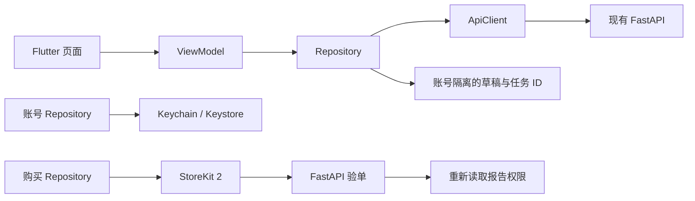

# FATE APP 主架构与迁移记录

依据用户提供的《泰国占星 App 首版技术方案 v1.0》，迁移 APP 端技术框架；首版业务范围按后续明确指示限定为西洋占星、报告、Apple 内购和登录。H5 与后端继续由现有工程承载，服务端 PostgreSQL、Worker、LINE 和支付回调不是这次 APP 端修改的交付范围。

## 运行入口

- APP 主工程：`app/lib/main.dart` → `app/lib/app/fate_app.dart`。
- 默认开发命令：根目录 `pnpm dev`，启动现有 FastAPI 和 Flutter APP 预览。
- 单独启动：`pnpm dev:app`，默认端口 5174；需要已有 FastAPI 8000 服务。
- 原 React 比对预览：`pnpm dev:react-preview`，端口 5175。它作为迁移保留项，不承担原生内购。
- 现有 React 构建和 Vitest 命令保留，供依赖核查与旧功能对照。

Flutter Web 预览与原生 App 使用同一份 Dart 页面、ViewModel 与 Repository。`scripts/serve-app.mjs` 只负责本地静态资源与 API 同源转发，不进行测算、生成报告或发放权益。原生 App 直接访问配置的 HTTPS FastAPI。

APP 浏览器预览默认使用 Flutter release / WebAssembly 构建，`pnpm build:app:preview` 与启动命令共用同一构建流程，Flutter 根据浏览器能力选择 Wasm 或生成的 JavaScript 构建。预览服务按 ETag 校验静态资源缓存。`?startup=1#/fortune` 可在开发者控制台输出实际首帧耗时及关键资源时序，普通访问不输出这些诊断信息。

## 分层与职责

| 位置 | 责任 |
| --- | --- |
| `app/lib/app` | 依赖装配、go_router、账号与语言的全局展示状态 |
| `app/lib/features/*` | Home、Chart、Reports、Account、Purchases 页面与 ViewModel |
| `app/lib/data` | 账号、档案、测算、报告、订单及商店 Repository |
| `app/lib/core/network` | HTTP、错误码、会话轮换、幂等键、超时 |
| `app/lib/core/models` | 档案版本、受限盘面、报告权限与章节数据 |
| `app/lib/core/storage` | Keychain/Keystore 凭证和按账号隔离的本地草稿 |
| `app/lib/l10n` | 泰、英、中、越 ARB 及生成的类型化文案 |
| `app/lib/ui` | 共用主题与阅读组件 |



页面不直接访问 HTTP、数据库或 Roxy；不在客户端排盘或用随机内容冒充个人结果。教学示例明确标记，并且展开示例不会创建订单或报告权益。

## 已落实的约束

- 日期输入统一使用公历，保存为 ISO 日期，未知时分保留 null。APP 出生资料页不显示称呼和时区输入；国家、省／府、城市采用与落地页相同的输入搜索和候选列表交互，按所选城市保存经纬度与 IANA 时区。
- 依赖出生时间的上升和宫位只展示服务端提供的有效数据。日期精度结果夹带这些字段时拒绝解析。
- 西洋结果必须标识 western_natal，避免把泰式结果当作西洋星盘。
- 计算与报告固定绑定档案版本和结果 ID；报告语言标识与当前界面不一致、结果不匹配或试读返回完整付费正文时拒绝解析。
- 会话凭证使用 flutter_secure_storage；退出和切换账号会使旧请求失效。
- 星盘入口在没有已提交档案时直接显示出生资料表单。游客无需注册或登录即可提交资料、计算个人星盘和生成报告；本机恢复同一游客的资料和报告。已有完整档案时继续查看自己的星盘，并可重新编辑资料。
- 游客使用独立匿名会话，接口仍按所属用户校验资料、计算和报告；注册账号前不创建账号记录。现有开发注册接口仅在用户主动注册时保留当前游客所属记录；登录已有账号不自动合并游客资料。旧服务器接口读取不会触发八字重算。
- 出生地目录按当前后端支持提供泰国、中国、越南和美国的国家选择；查询参数和返回时区按实际接口适配。不提供手动时区输入，更多国家需扩展地点目录后再开放。
- 报告每三秒按需读取任务状态，进入后台或离开页面停止轮询，回到前台重新读取；页面切换期间仅当前报告页面能停止自身的轮询，避免旧页面销毁时中断新报告。本地保留任务定位信息，正文权限仍由服务端判断。
- 内购先创建绑定账号与报告的订单，再从商店读取 SKU 和价格。只接收匹配 appAccountToken 的 StoreKit 2 交易，服务端验单成功后才完成交易。
- 验单等待或失败时提供重新验证，同一交易沿用原请求键；不会通过再次购买重试验单。
- 客户端不保存自制的“已购”标记，不自行解锁真实付费正文。

## 与当前后端的实际边界

2026-11-11：Flutter APP 已接入 RoxyAPI 的真实西洋本命盘。服务端配置 `ROXY_ENABLED=true` 且存在 `ROXY_API_KEY` 时，`western_astrology` 才标记为 ready；模型配置可用时才开启 `western_reports`。教学示例仍有独立明确标识，不作为失败时的替代结果。Apple 登录及验单仍未启用。

APP 使用 `/api/calculations` 和 `/api/western/reports`。`/api/life-reports` 保留给现有 H5 的匿名报告和订单流程，避免改变其数据及权限。`backend/app/astrology.py` 是共用 Roxy 排盘适配器；`backend/app/western_app.py` 管理 APP 账号所属的计算快照、报告任务与同意记录。模型传输、费用限流、重试与缓存复用现有报告服务，客户端不持有供应商密钥。

游客首次提交出生资料时调用 `POST /api/auth/guest`，取得独立的私有会话，再沿用 `/api/profile`、`/api/calculations`、同意说明及报告接口。凭证存入安全存储，不出现在地址栏；刷新时通过 `/api/auth/me` 恢复所属身份，按档案版本和语言恢复报告。清除浏览器数据或会话过期后，游客不能保证恢复原记录。游客能力在生产环境也可使用，旧的开发登录、历史及八字资料写入接口继续受环境限制。游客不会因此获得付费权益。

服务端根据真实配置下发能力声明，当前本地开发环境的值为：

```json
{
  "guest_reading": true,
  "app_capabilities": {
    "western_reports": true,
    "apple_login": false,
    "apple_iap": false,
    "ai_notice_version": "western-ai-reading-2026-11-11",
    "development_full_reports": true
  }
}
```

缺失能力字段时客户端关闭相应调用。报告生成前展示同意说明，并通过 `/api/privacy/consents` 记录本账号的用途和版本。报告绑定当前档案版本、计算结果 ID 与语言；跨账号不可读取。开发环境通过服务端 `development_preview` 明确免费展示完整报告，界面显示说明；这不创建订单或伪造 StoreKit 权益。生产环境仅返回试读，完整正文不下发；正式内购仍需独立验收。

## Roxy 西洋占星规则与报告

- 权威接口：`POST https://roxyapi.com/api/v2/astrology/natal-chart`；服务端携带 `X-API-Key`。请求包括公历生日、当地时分秒、出生地经纬度、IANA 时区、`houseSystem=placidus`、`nodeType=true`。不同时进行 UTC 转换和重复时区偏移。
- 黄道为热带黄道；APP 首屏展示太阳、月亮、上升，盘面展示十个主要行星、真实宫头、上升和天顶。Roxy 返回的额外天体保留在服务器原始快照，首版不强加额外解释规则。
- 相位采用 Roxy 返回的合相 0°、六分相 60°、四分相 90°、三分相 120°、对分相 180°，只展示容许度不大于 6°的主要行星相位。这是本产品的展示及解读筛选规则，不是供应商全部相位的边界。返回角度、星座与度数、逆行和输入回显均校验。
- 时间未知时使用官方支持的当地 12:00 估算，显式标识为 date_only；不输出月亮、上升、天顶、宫位、相位及含宫位的原始解释。按行星速度检查星座交界附近的不确定性，相关位置也隐藏。不得据此编造精确事件或时间预测。
- 星盘按完整出生资料、档案版本、规则版本与账号缓存；修改出生资料后的旧版本请求返回冲突。刷新命中已存快照，不重复发起付费排盘调用。
- 报告的本机定位记录包含游客或账号作用域、结果 ID、语言和出生资料版本。会话恢复后只自动继续同语言、同版本的已选报告；更改出生资料后清空当前展示，历史报告仍按所属身份保留。
- Roxy 的西洋占星解读暂不覆盖泰语、越南语；简体中文在该领域也可能回退英文。因此取英文的标准结构与原始解释，由服务端模型整理为 th/en/zh/vi，校验输出语言和事实引用，不将英文回退正文直接展示。

| 报告维度 | 使用的主要事实 | 普通用户看到的内容 |
| --- | --- | --- |
| 个人特质 | 太阳、月亮、水星及第 1、3 宫和相关相位 | 做事和表达习惯、优势、具体生活例子 |
| 事业发展 | 太阳、水星、火星、土星、天顶、第 6、10 宫和相关相位 | 工作方式、协作条件、技能及责任边界 |
| 财务习惯 | 金星、木星、土星、第 2、8 宫和相关相位 | 收支安排、共同资源、消费边界；不承诺收益 |
| 感情与家庭 | 月亮、金星、火星、第 4、5、7 宫和相关相位 | 亲密需要、沟通习惯、共同责任；不冒充双人合盘 |
| 需要留意的地方 | 火星、土星、海王星、冥王星、第 6、12 宫和相关相位 | 可调整的压力反应、回避或过度承担模式 |
| 行动建议 | 太阳、水星、土星、第 1、6、10 宫和相关相位 | 按优先顺序给出可以实际执行的行为和复盘方法 |

每个维度包含一段解读、一个条件式生活例子和两条带理由的可执行建议。每段主题须引用至少两个相关的已有事实，后台保留引用用于追溯，正文不堆砌专业术语。当前只有本命盘，不生成年度行运、吉日、配对分数等没有相应计算支持的内容。事实匹配与接口一致性不等于现实预测准确率。

中文普通表达校验会一次列出全部不合格词语及改写方向，应用生成的纠错要求与不可信的草稿正文分开处理；仍沿用最多两次尝试的费用边界。改写失败时显示可重试状态，不用示例内容冒充个人报告。

财务章节不能编造家庭财力、继承或已有资产，也不能按未知收入强行规定消费金额或储蓄比例。应提示用户按实际收入和必要开支设定预算。

官方依据：[西洋占星](https://roxyapi.com/docs/guides/astrology)、[结构化计算与解读](https://roxyapi.com/docs/guides/calculation-engine)、[语言覆盖](https://roxyapi.com/docs/guides/localization)、[OpenAPI](https://roxyapi.com/api/v2/openapi.json)。

塔罗、数字命理仅在能力目录标记 planned，暂无可执行入口。后续分别接入自己的抽牌/牌位规则和姓名/生日数值体系；复用账号、报告任务、语言、付费权限与限流基础设施，不混用西洋行星和宫位规则。

2026-11-11 本机验证：Flutter 23 项测试通过，相关后端 71 项测试通过，Web release/Wasm 构建完成。用虚构出生资料实际调用 Roxy；完整盘返回 14 个天体、12 宫和 37 个全部相位，APP 筛选后输出 32 条规范事实。另一组未知时分资料只返回部分行星事实。首次 APP 排盘约 3.23 秒，同资料缓存读取约 18 毫秒；四种语言的六维报告实测约 28–35 秒。已在浏览器确认真实星盘、相位、中文/泰语正文、语言隔离和刷新后恢复所选报告。这些是本机单次链路测量，不代表移动网络或 iOS 真机性能。

## 保留与清理原则

已被替代且没有调用方的旧 APP 页面可以删除。仍被共享控件、排盘验收、数据脚本或当前功能依赖的代码保留；不能因文件名称包含旧体系就整目录删除。

| 保留项 | 原因与后续处理条件 |
| --- | --- |
| React 西洋占星预览和其共用出生选择器 | 当前可运行的对照基线；原生真机、账号、地点及支付联调通过后再移除 |
| 旧账户开发登录接口适配 | 当前 FastAPI 使用此接口；Apple/LINE 正式登录上线后移除。正式 iOS release 不展示开发表单；本地 Web 预览需同时满足编译标记 `FATE_DEVELOPMENT_PREVIEW=true`、回环地址和服务端开发登录开关 |
| 旧泰式、八字的计算代码、验收页面、测试与数据 | 仍用于已接入能力验收或后续功能；避免影响后端和现有数据脚本 |
| `WanjaiShared` 与仍有引用的类型/控件 | 部分保留页面仍导入它，先保留直到调用者迁移 |
| H5 目录、后端持久数据、环境密钥 | 当前 APP 迁移继续依赖现有服务，保持原有归属和位置 |

清理的实际文件见 `APP_CLEANUP.json`。保留项不是重复的生产实现；APP 的后续开发入口为 Flutter 工程。

## 发布前尚需完成的外部联调

1. 扩充西洋参考盘样本，完成跨时区、历史夏令时与未知出生时间的原生真机验收。
2. 开发者账号、正式 Bundle ID、Apple 登录、商品 SKU、交易通知与沙箱验单。
3. 在 macOS/Xcode 上完成 iOS 真机、签名与提审包；Windows 上的 Web 编译不代表 iOS 验收完成。
4. 账号删除、隐私说明、生产 HTTPS 和真实域名的 Universal Links 联调。
5. StoreKit 的成功、取消、待处理、恢复、退款与多账号隔离测试。

以上是发布依赖，不应在依赖完成前打开收费开关或宣称已经可以提交商店审核。
