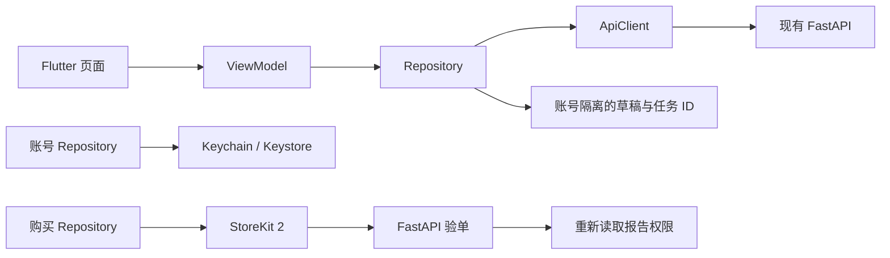

# FATE APP 主架构与迁移记录

依据用户提供的《泰国占星 App 首版技术方案 v1.0》，迁移 APP 端技术框架；首版业务范围按后续明确指示限定为西洋占星、报告、Apple 内购和登录。H5 与后端继续由现有工程承载，服务端 PostgreSQL、Worker、LINE 和支付回调不是这次 APP 端修改的交付范围。

## 运行入口

- APP 主工程：`app/lib/main.dart` → `app/lib/app/fate_app.dart`。
- 默认开发命令：根目录 `pnpm dev`，启动现有 FastAPI 和 Flutter APP 预览。
- 单独启动：`pnpm dev:app`，默认端口 5174；需要已有 FastAPI 8000 服务。
- 原 React 比对预览：`pnpm dev:react-preview`，端口 5175。它作为迁移保留项，不承担原生内购。
- 现有 React 构建和 Vitest 命令保留，供依赖核查与旧功能对照。

Flutter Web 预览与原生 App 使用同一份 Dart 页面、ViewModel 与 Repository。`scripts/serve-app.mjs` 只负责本地静态资源与 API 同源转发，不进行测算、生成报告或发放权益。原生 App 直接访问配置的 HTTPS FastAPI。

APP 浏览器预览默认使用 Flutter release / WebAssembly 构建，`pnpm build:app:preview` 与启动命令共用同一构建流程，Flutter 根据浏览器能力选择 Wasm 或生成的 JavaScript 构建。预览服务按 ETag 校验静态资源缓存。`?startup=1#/fortune` 可在开发者控制台输出实际首帧耗时及关键资源时序，普通访问不输出这些诊断信息。

## 分层与职责

| 位置 | 责任 |
| --- | --- |
| `app/lib/app` | 依赖装配、go_router、账号与语言的全局展示状态 |
| `app/lib/features/*` | Home、Chart、Reports、Account、Purchases 页面与 ViewModel |
| `app/lib/data` | 账号、档案、测算、报告、订单及商店 Repository |
| `app/lib/core/network` | HTTP、错误码、会话轮换、幂等键、超时 |
| `app/lib/core/models` | 档案版本、受限盘面、报告权限与章节数据 |
| `app/lib/core/storage` | Keychain/Keystore 凭证和按账号隔离的本地草稿 |
| `app/lib/l10n` | 泰、英、中、越 ARB 及生成的类型化文案 |
| `app/lib/ui` | 共用主题与阅读组件 |



页面不直接访问 HTTP、数据库或 Roxy；不在客户端排盘或用随机内容冒充个人结果。教学示例明确标记，并且展开示例不会创建订单或报告权益。

## 已落实的约束

- 日期统一保存为 ISO 公历；输入可切换公历与佛历，未知时分保留 null。
- 依赖出生时间的上升和宫位只展示服务端提供的有效数据。日期精度结果夹带这些字段时拒绝解析。
- 西洋结果必须标识 western_natal，避免把泰式结果当作西洋星盘。
- 计算与报告固定绑定档案版本和结果 ID；报告语言标识与当前界面不一致、结果不匹配或试读返回完整付费正文时拒绝解析。
- 会话凭证使用 flutter_secure_storage；退出和切换账号会使旧请求失效。
- 正式登录不自动认领游客档案。可恢复已有账号的出生资料；旧服务器接口读取不会触发八字重算。
- 出生地目录按当前后端支持提供泰国、中国、越南和美国的国家选择；查询参数和返回时区按实际接口适配。其他地点保留手动地点、时区输入，完整覆盖需随正式地点服务验收。
- 报告每三秒按需读取任务状态，进入后台或离开页面停止轮询，回到前台重新读取；本地保留任务定位信息，正文权限仍由服务端判断。
- 内购先创建绑定账号与报告的订单，再从商店读取 SKU 和价格。只接收匹配 appAccountToken 的 StoreKit 2 交易，服务端验单成功后才完成交易。
- 验单等待或失败时提供重新验证，同一交易沿用原请求键；不会通过再次购买重试验单。
- 客户端不保存自制的“已购”标记，不自行解锁真实付费正文。

## 与当前后端的实际边界

当前 `/api/config` 仍将 western_astrology 标为 planned。现有后端尚未提供已验收的西洋结果、对应报告以及 Apple 验单能力，因此首版预览展示教学星盘和报告流程；不会调用八字或泰式接口代替西洋测算。

客户端期望的 `/api/calculations`、`/api/life-reports`、`/api/orders`、Apple 登录与刷新会话来自方案文档。报告 JSON 的细节及订单绑定参数仍需以服务端正式 OpenAPI 为准。目前 Dart DTO 不能视为后端已经实现的证明。

为避免仅开启一个测算模块就误开收费或 AI，客户端还预留以下**待后端签版的能力声明**：

```json
{
  "app_capabilities": {
    "western_reports": false,
    "apple_login": false,
    "apple_iap": false,
    "ai_notice_version": null
  }
}
```

这些字段当前没有被写入后端配置。缺失时安全关闭相应调用。报告生成前需要展示同意说明，并通过方案中的隐私接口记录同意。

## 保留与清理原则

已被替代且没有调用方的旧 APP 页面可以删除。仍被共享控件、排盘验收、数据脚本或当前功能依赖的代码保留；不能因文件名称包含旧体系就整目录删除。

| 保留项 | 原因与后续处理条件 |
| --- | --- |
| React 西洋占星预览和其共用出生选择器 | 当前可运行的对照基线；原生真机、账号、地点及支付联调通过后再移除 |
| 旧账户开发登录接口适配 | 当前 FastAPI 使用此接口；Apple/LINE 正式登录上线后移除开发适配，release 构建不展示开发账号表单 |
| 旧泰式、八字的计算代码、验收页面、测试与数据 | 仍用于已接入能力验收或后续功能；避免影响后端和现有数据脚本 |
| `WanjaiShared` 与仍有引用的类型/控件 | 部分保留页面仍导入它，先保留直到调用者迁移 |
| H5 目录、后端持久数据、环境密钥 | 当前 APP 迁移继续依赖现有服务，保持原有归属和位置 |

清理的实际文件见 `APP_CLEANUP.json`。保留项不是重复的生产实现；APP 的后续开发入口为 Flutter 工程。

## 发布前尚需完成的外部联调

1. 后端西洋排盘与报告正式契约、真实参考盘和受限生辰验收。
2. 开发者账号、正式 Bundle ID、Apple 登录、商品 SKU、交易通知与沙箱验单。
3. 在 macOS/Xcode 上完成 iOS 真机、签名与提审包；Windows 上的 Web 编译不代表 iOS 验收完成。
4. 账号删除、隐私说明、生产 HTTPS 和真实域名的 Universal Links 联调。
5. StoreKit 的成功、取消、待处理、恢复、退款与多账号隔离测试。

以上是发布依赖，不应在依赖完成前打开收费开关或宣称已经可以提交商店审核。
