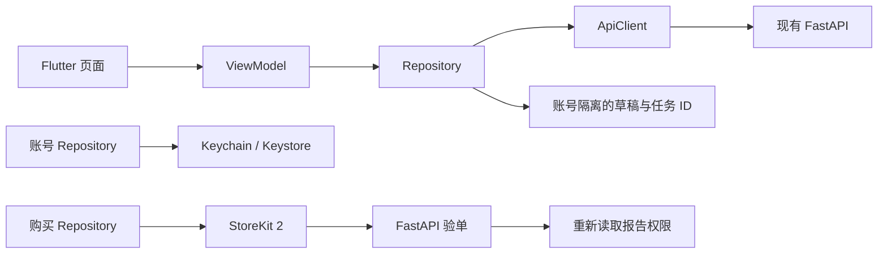

# FATE APP 主架构与迁移记录

依据用户提供的《泰国占星 App 首版技术方案 v1.0》，迁移 APP 端技术框架。2026-11-11 的首版范围为西洋占星、报告、Apple 内购和登录；2026-11-15 按后续要求加入神殿、四神明陪聊、占卜工具和羁绊，视觉沿用实际 H5。H5 与后端继续由现有工程承载，服务端 PostgreSQL、Worker、LINE 和支付回调不是这次 APP 视觉修改的交付范围。

## 运行入口

- APP 主工程：`app/lib/main.dart` → `app/lib/app/fate_app.dart`。
- 统一仓库位于 `D:/desktop/FATE`，本工程是其中的 `TH/` 子目录；H5 位于相邻的 `western-astrology-h5 4/`。
- 统一开发命令：根目录 `node TH/scripts/dev.mjs`，启动现有 FastAPI、Flutter App 和 H5。App 默认 5176，API 默认 8000，支持指定本地端口。
- 仅重建 App 预览：`node TH/scripts/flutter-app.mjs build-preview`；已构建后统一启动可带 `--skip-build`。
- 原 React 比对预览：`pnpm dev:react-preview`，端口 5175。它作为迁移保留项，不承担原生内购。
- 现有 React 构建和 Vitest 命令保留，供依赖核查与旧功能对照。

Flutter Web 预览与原生 App 使用同一份 Dart 页面、ViewModel 与 Repository。`scripts/serve-app.mjs` 只负责本地静态资源与 API 同源转发，不进行测算、生成报告或发放权益。原生 App 直接访问配置的 HTTPS FastAPI。

APP 浏览器预览默认使用 Flutter release / WebAssembly 构建，`pnpm build:app:preview` 与启动命令共用同一构建流程，Flutter 根据浏览器能力选择 Wasm 或生成的 JavaScript 构建。预览服务按 ETag 校验静态资源缓存。`?startup=1#/fortune` 可在开发者控制台输出实际首帧耗时及关键资源时序，普通访问不输出这些诊断信息。

## 分层与职责

| 位置 | 责任 |
| --- | --- |
| `app/lib/app` | 依赖装配、go_router、账号与语言的全局展示状态 |
| `app/lib/features/*` | Home、Chart、Reports、Account、Purchases 页面与 ViewModel |
| `app/lib/data` | 账号、档案、测算、报告、订单及商店 Repository |
| `app/lib/core/network` | HTTP、错误码、会话轮换、幂等键、超时 |
| `app/lib/core/models` | 档案版本、受限盘面、报告权限与章节数据 |
| `app/lib/core/storage` | Keychain/Keystore 凭证和按账号隔离的本地草稿 |
| `app/lib/l10n` | 泰、英、中、越 ARB 及生成的类型化文案 |
| `app/lib/ui` | 共用主题与阅读组件 |



页面不直接访问 HTTP、数据库或 Roxy；不在客户端排盘或用随机内容冒充个人结果。教学示例明确标记，并且展开示例不会创建订单或报告权益。

## 已落实的约束

- 日期输入统一使用公历，保存为 ISO 日期，未知时分保留 null。APP 出生资料页不显示称呼和时区输入；国家、省／府、城市采用与落地页相同的输入搜索和候选列表交互，按所选城市保存经纬度与 IANA 时区。
- 未知出生时分继续保存为 null，排盘按出生地当地 12:00 计算。APP 以 `estimated_time` 和逐项 `estimated=true` 展示全部行星（含月亮）、上升、十二宫及相位，页面明确标记估算与时间依据。缺少估算标记或默认时间依据的字段仍拒绝解析；原 `date_only` 受限结果保持原校验。已缓存的星盘与报告按原 Roxy 盘重新构建展示数据，无需再次调用排盘接口。
- 估算盘的展示与报告结论区分处理：未提供出生时分时，报告仍只使用日期可支持的可靠行星信息，剔除月亮、宫位、角度、相位及临近换座边界的位置，避免把中午盘当作真实出生盘解释。
- 西洋结果必须标识 western_natal，避免把泰式结果当作西洋星盘。
- 计算与报告固定绑定档案版本和结果 ID；报告语言标识与当前界面不一致、结果不匹配或试读返回完整付费正文时拒绝解析。
- 会话凭证使用 flutter_secure_storage；退出和切换账号会使旧请求失效。
- 星盘入口在没有已提交档案时直接显示出生资料表单。游客无需注册或登录即可提交资料、计算个人星盘和生成报告；本机恢复同一游客的资料和报告。已有完整档案时继续查看自己的星盘，并可重新编辑资料。
- 游客使用独立匿名会话，接口仍按所属用户校验资料、计算和报告；注册账号前不创建账号记录。现有开发注册接口仅在用户主动注册时保留当前游客所属记录；登录已有账号不自动合并游客资料。旧服务器接口读取不会触发八字重算。
- 出生地目录按当前后端支持提供泰国、中国、越南和美国的国家选择；查询参数和返回时区按实际接口适配。不提供手动时区输入，更多国家需扩展地点目录后再开放。
- 报告每三秒按需读取任务状态，进入后台或离开页面停止轮询，回到前台重新读取；页面切换期间仅当前报告页面能停止自身的轮询，避免旧页面销毁时中断新报告。本地保留任务定位信息，正文权限仍由服务端判断。
- 内购先创建绑定账号与报告的订单，再从商店读取 SKU 和价格。只接收匹配 appAccountToken 的 StoreKit 2 交易，服务端验单成功后才完成交易。
- 验单等待或失败时提供重新验证，同一交易沿用原请求键；不会通过再次购买重试验单。
- 客户端不保存自制的“已购”标记，不自行解锁真实付费正文。

## 与当前后端的实际边界

2026-11-11：Flutter APP 已接入 RoxyAPI 的真实西洋本命盘。服务端配置 `ROXY_ENABLED=true` 且存在 `ROXY_API_KEY` 时，`western_astrology` 才标记为 ready；模型配置可用时才开启 `western_reports`。教学示例仍有独立明确标识，不作为失败时的替代结果。Apple 登录及验单仍未启用。

APP 使用 `/api/calculations` 和 `/api/western/reports`。`/api/life-reports` 保留给现有 H5 的匿名报告和订单流程，避免改变其数据及权限。`backend/app/astrology.py` 是共用 Roxy 排盘适配器；`backend/app/western_app.py` 管理 APP 账号所属的计算快照、报告任务与同意记录。模型传输、费用限流、重试与缓存复用现有报告服务，客户端不持有供应商密钥。

游客首次提交出生资料时调用 `POST /api/auth/guest`，取得独立的私有会话，再沿用 `/api/profile`、`/api/calculations`、同意说明及报告接口。凭证存入安全存储，不出现在地址栏；刷新时通过 `/api/auth/me` 恢复所属身份，按档案版本和语言恢复报告。清除浏览器数据或会话过期后，游客不能保证恢复原记录。游客能力在生产环境也可使用，旧的开发登录、历史及八字资料写入接口继续受环境限制。游客不会因此获得付费权益。

服务端根据真实配置下发能力声明，当前本地开发环境的值为：

```json
{
  "guest_reading": true,
  "app_capabilities": {
    "western_reports": true,
    "apple_login": false,
    "apple_iap": false,
    "ai_notice_version": "western-ai-reading-2026-11-11",
    "development_full_reports": true
  }
}
```

缺失能力字段时客户端关闭相应调用。报告生成前展示同意说明，并通过 `/api/privacy/consents` 记录本账号的用途和版本。报告绑定当前档案版本、计算结果 ID 与语言；跨账号不可读取。开发环境通过服务端 `development_preview` 明确免费展示完整报告，界面显示说明；这不创建订单或伪造 StoreKit 权益。生产环境仅返回试读，完整正文不下发；正式内购仍需独立验收。

## Roxy 西洋占星规则与报告

- 权威接口：`POST https://roxyapi.com/api/v2/astrology/natal-chart`；服务端携带 `X-API-Key`。请求包括公历生日、当地时分秒、出生地经纬度、IANA 时区、`houseSystem=placidus`、`nodeType=true`。不同时进行 UTC 转换和重复时区偏移。
- 黄道为热带黄道；APP 首屏展示太阳、月亮、上升，盘面展示十个主要行星、真实宫头、上升和天顶。Roxy 返回的额外天体保留在服务器原始快照，首版不强加额外解释规则。
- 相位采用 Roxy 返回的合相 0°、六分相 60°、四分相 90°、三分相 120°、对分相 180°，只展示容许度不大于 6°的主要行星相位。这是本产品的展示及解读筛选规则，不是供应商全部相位的边界。返回角度、星座与度数、逆行和输入回显均校验。
- 时间未知时使用官方支持的当地 12:00 估算，显式标识为 date_only；不输出月亮、上升、天顶、宫位、相位及含宫位的原始解释。按行星速度检查星座交界附近的不确定性，相关位置也隐藏。不得据此编造精确事件或时间预测。
- 星盘按完整出生资料、档案版本、规则版本与账号缓存；修改出生资料后的旧版本请求返回冲突。刷新命中已存快照，不重复发起付费排盘调用。
- 报告的本机定位记录包含游客或账号作用域、结果 ID、语言和出生资料版本。会话恢复后只自动继续同语言、同版本的已选报告；更改出生资料后清空当前展示，历史报告仍按所属身份保留。
- 星盘底部“全部解读”直接进入 `/chart/reading`，通过根 Navigator 展示独立页面，不显示底部导航。优先读取同一结果、同语言的已有报告；首次生成沿用 AI 用途确认和原有生成、审查流程。详情页展示星盘、结论及六个章节，可通过目录跳转到各章节。
- 新任务生成时进入独立进度页 `/chart/generating?report=...`，沿用原任务的状态查询，每 3 秒更新一次，避开共用接口每分钟 30 次的限流；界面按实际收到的完整字段、六个主题及审查覆盖数量推进，不按等待时间填充进度。完成整份审查后才达到 100%，自动打开同一报告的解读页；已完成的缓存报告直接打开。离开或刷新后可恢复所选任务，离开与后台状态停止页面轮询，服务端任务继续运行。失败停留在进度页并提供返回报告、重新生成的入口，不提前展示草稿。状态查询暂时失败时保留已有进度，明确提示后台任务没有取消，并在原有有限自动重连后保留手动重连入口。
- 星盘解读记录迁入独立的 `/chart/readings`，从解读页右上角“历史解读”进入。底部 `/reports` 不展示星盘报告及生成入口；返回星盘后恢复底部导航。历史正文及本机示例保存能力保留。
- “我的 → 报告”进入独立记录页 `/chart/readings?from=profile`，顶部按编号搜索，记录显示编号、生成时间和状态。服务端为新旧 APP 报告分配唯一、稳定的 `FATE-` 编号；搜索在所属用户和当前语言范围内执行，不限于客户端已加载的记录。列表最多返回最新 100 个匹配结果。
- 删除需要用户确认并调用所属用户的 DELETE 接口。生成中的任务拒绝删除；完成后删除报告记录、清除对应本机续读定位，保留共享排盘与其他报告。迟到的搜索响应不会覆盖新搜索或恢复已删除记录。该功能不改变 H5 报告与订单接口。
- 报告接口携带原计算快照 `calculation`，按报告结果 ID 和所属用户关联读取；客户端再次校验快照 ID。旧报告展示原来的星盘，不借用当前已修改的出生资料重新绘图；试读接口仍不下发付费正文。
- Roxy 的西洋占星解读暂不覆盖泰语、越南语；简体中文在该领域也可能回退英文。因此取英文的标准结构与原始解释，由服务端模型整理为 th/en/zh/vi，校验输出语言和事实引用，不将英文回退正文直接展示。

| 报告维度 | 使用的主要事实 | 普通用户看到的内容 |
| --- | --- | --- |
| 个人特质 | 太阳、月亮、水星及第 1、3 宫和相关相位 | 做事和表达习惯、优势、具体生活例子 |
| 事业发展 | 太阳、水星、火星、土星、天顶、第 6、10 宫和相关相位 | 工作方式、协作条件、技能及责任边界 |
| 财务习惯 | 金星、木星、土星、第 2、8 宫和相关相位 | 收支安排、共同资源、消费边界；不承诺收益 |
| 感情与家庭 | 月亮、金星、火星、第 4、5、7 宫和相关相位 | 亲密需要、沟通习惯、共同责任；不冒充双人合盘 |
| 需要留意的地方 | 火星、土星、海王星、冥王星、第 6、12 宫和相关相位 | 可调整的压力反应、回避或过度承担模式 |
| 行动建议 | 太阳、水星、土星、第 1、6、10 宫和相关相位 | 按优先顺序给出可以实际执行的行为和复盘方法 |

每个维度包含一段解读、一个条件式生活例子和两条带理由的可执行建议。每段主题通常须引用至少两个相关的已有事实；未知出生时分使某主题只剩一个直接相关事实时，引用该事实及另一个可靠行星作背景，收窄结论并保留缺失边界。后台保留引用用于追溯，正文不堆砌专业术语。当前只有本命盘，不生成年度行运、吉日、配对分数等没有相应计算支持的内容。事实匹配与接口一致性不等于现实预测准确率。

中文普通表达校验会一次列出全部不合格词语及改写方向，应用生成的纠错要求与不可信的草稿正文分开处理；仍沿用最多两次尝试的费用边界。改写失败时显示可重试状态，不用示例内容冒充个人报告。

财务章节不能编造家庭财力、继承或已有资产，也不能按未知收入强行规定消费金额或储蓄比例。应提示用户按实际收入和必要开支设定预算。

本地 APP 新增 Roxy 来源审查、报告整理与最终审查，相关角色可独立更换模型。流程、环境配置、失败边界及 H5 后续迁移条件见 [WESTERN_REVIEW.md](WESTERN_REVIEW.md)。该开关仅影响 APP 报告，H5 仍沿用原实现。

官方依据：[西洋占星](https://roxyapi.com/docs/guides/astrology)、[结构化计算与解读](https://roxyapi.com/docs/guides/calculation-engine)、[语言覆盖](https://roxyapi.com/docs/guides/localization)、[OpenAPI](https://roxyapi.com/api/v2/openapi.json)。

2026-11-11 的能力目录中塔罗、数字命理标记 planned。后续神殿前端已加入本地塔罗抽牌和按日期计算的幸运数字；七字数字命理尚未接入，不能把这些轻工具说成已完成七字算法。原生页面继续复用账号、报告任务、语言和服务端付费权限。

单模型整理链路的旧基准（2026-11-11）：Flutter 23 项测试通过，相关后端 71 项测试通过，Web release/Wasm 构建完成。用虚构出生资料实际调用 Roxy；完整盘返回 14 个天体、12 宫和 37 个全部相位，APP 筛选后输出 32 条规范事实。另一组未知时分资料只返回部分行星事实。首次 APP 排盘约 3.23 秒，同资料缓存读取约 18 毫秒；四种语言的六维报告当时实测约 28–35 秒。已在浏览器确认真实星盘、相位、中文/泰语正文、语言隔离和刷新后恢复所选报告。加入来源和成稿审查后的新耗时及回归结果见 WESTERN_REVIEW.md。这些是本机单次链路测量，不代表移动网络或 iOS 真机性能。

## 保留与清理原则

已被替代且没有调用方的旧 APP 页面可以删除。仍被共享控件、排盘验收、数据脚本或当前功能依赖的代码保留；不能因文件名称包含旧体系就整目录删除。

| 保留项 | 原因与后续处理条件 |
| --- | --- |
| React 西洋占星预览和其共用出生选择器 | 当前可运行的对照基线；原生真机、账号、地点及支付联调通过后再移除 |
| 旧账户开发登录接口适配 | 当前 FastAPI 使用此接口；Apple/LINE 正式登录上线后移除。正式 iOS release 不展示开发表单；本地 Web 预览需同时满足编译标记 `FATE_DEVELOPMENT_PREVIEW=true`、回环地址和服务端开发登录开关 |
| 旧泰式、八字的计算代码、验收页面、测试与数据 | 仍用于已接入能力验收或后续功能；避免影响后端和现有数据脚本 |
| `WanjaiShared` 与仍有引用的类型/控件 | 部分保留页面仍导入它，先保留直到调用者迁移 |
| H5 目录、后端持久数据、环境密钥 | 当前 APP 迁移继续依赖现有服务，保持原有归属和位置 |

清理的实际文件见 `APP_CLEANUP.json`。保留项不是重复的生产实现；APP 的后续开发入口为 Flutter 工程。

## 发布前尚需完成的外部联调

1. 扩充西洋参考盘样本，完成跨时区、历史夏令时与未知出生时间的原生真机验收。
2. 开发者账号、正式 Bundle ID、Apple 登录、商品 SKU、交易通知与沙箱验单。
3. 在 macOS/Xcode 上完成 iOS 真机、签名与提审包；Windows 上的 Web 编译不代表 iOS 验收完成。
4. 账号删除、隐私说明、生产 HTTPS 和真实域名的 Universal Links 联调。
5. StoreKit 的成功、取消、待处理、恢复、退款与多账号隔离测试。

以上是发布依赖，不应在依赖完成前打开收费开关或宣称已经可以提交商店审核。

## 2026-11-15 神殿视觉与交互落地

本次在现有 `app/lib/main.dart` 调用链内修改，没有另建原型。修改前 App 源码已备份到 `D:/Backups/FATE-app-ui-20261115/`；未操作业务订单数据库或创建真实支付订单。

### 已确定的页面结构

- 首页保持「神庙欢迎 → 今日泰历及星盘入口 → 每日运势 → 有历史时接着聊 → 四神明两列卡片 → 每日一签 → 原有功能入口」。出生资料、幸运数字、星盘、报告和完整解读入口均保留。
- 四位神明为原创拟人半写实插画：爱情、事业、财运、健康。人设切换留在下一版；当前图片和界面动效不是实时虚拟人或口型动画。
- 占卜页保留每日一签、幸运数字、每周事件、星座运势、星盘、报告及泰历。周度入口携带问题和周期进入既有陪聊；没有伪造独立周报。尚未加入 H5 WebView 桥接。
- 羁绊显示实际已完成对话对应的关系阶段、共同记忆与近期对话；首次使用显示空状态，不填充虚构的关系百分比。
- 更多页统一账号、出生资料、报告、购买、语言与数据说明。陪聊与报告的数据使用说明分开陈述；现有本机清除功能不等同于服务器账号删除。

### 视觉及交互

直接采用 H5 源码中的深紫 `#130C24`、面板 `#211733`、香槟金 `#E4BC78`、米白 `#FFF5DF` 和淡紫 `#B4A8C6`。使用真实 H5 品牌字标、原创泰式神庙画面、拱形神明人像、细边框和轻渐变；字体为本地 Noto Sans Thai / SC。星座符号使用本地 Noto Sans Symbols，避免系统彩色 Emoji 回退，字体及许可随包分发。

| 操作 | 实际效果 |
| --- | --- |
| 卡片按压、悬停、键盘聚焦 | 120ms 缩放与边框反馈 |
| 主导航切换 | 180ms 淡入淡出，选中状态过渡 |
| 详情进入、返回 | 300ms 轻位移及淡入，保留 iOS 侧滑返回 |
| 神明进入聊天 | 同一头像的 Hero 过渡；聊天内容及输入保持原状态 |
| 内容与记忆出现 | 380ms 入场，编辑时尺寸与文字过渡 |
| 弹窗与底部面板 | 240ms 打开、180ms 关闭，统一圆角与遮罩 |
| 抽牌 | 沿用现有洗牌、选牌飞入、翻牌与解读过程 |
| 等待回复与失败 | 真实请求期间显示倾听状态；失败保留草稿，可重连 |
| 键盘、小屏幕 | 引导和提示随聊天内容滚动，输入区留在可见位置 |

系统要求减少动态效果时关闭装饰性动效，不延长操作等待。不播放开场片时，首页新图和神明图在首帧前解码；开场片继续使用原有的视频过渡。交互时长以 `FateMotion` 和对应控件源码为准。

FATE 星芒图标已替换 Flutter 默认图标，涵盖 Android 各密度及自适应资源、iOS 的 25 个图标规格和 Web favicon / PWA 图标。源图为 `assets/images/fate-app-icon.png`，用 `dart run flutter_launcher_icons` 从现有 `pubspec.yaml` 配置生成。Android 与 iOS 启动背景改为同一深紫色。尺寸、iOS 商店图标无透明通道及 XML 引用已静态核对，仍需原生真机启动验收。

图标工具 0.14.4 存在 [上游问题 #634](https://github.com/fluttercommunity/flutter_launcher_icons/issues/634)，会把 Xcode 的 `ASSETCATALOG_COMPILER_GENERATE_SWIFT_ASSET_SYMBOL_EXTENSIONS` 误写成图标名称。本次已精确恢复为 `YES`；再次生成图标后应检查该字段，`ASSETCATALOG_COMPILER_APPICON_NAME` 则保持 `AppIcon`。

### 设计借鉴与素材

- [MUToday](https://mutoday.com/)：借鉴每日内容、泰历和小工具的层次，以及祈愿过程的仪式感。
- [Horoworld](https://www.horoworld.com/)：借鉴服务分类、人物入口和工具聚合方式。
- [Dribbble Astrology Tarot UI](https://dribbble.com/shots/26352427-Astrology-Tarot-App-UI-Design)：参考暗色界面、留白和金色焦点。同行的浅色品牌方案没有替换用户已确定的 H5 配色。
- 神明与 `temple-sanctuary.png` 为内置 imagegen 生成的原创插画；提示词和输出文件记录在 `app/assets/images/guardian-art-prompts.txt`。未复制同行商标、人像或付费素材。
- [Noto Sans Symbols](https://github.com/google/fonts/blob/main/ofl/notosanssymbols/METADATA.pb)：372684 字节的原始字体，12 个星座字形均存在；许可在 `assets/fonts/OFL-Symbols.txt`。

### 上架边界复核

截至本次代码核查，仍不能把本地预览称为商店可发布版本：

1. `backend/app/main.py:user` 在 production 返回 `production_disabled`；现有陪聊、历史和记忆接口依赖该入口。需要单独完成生产能力设计和验收，不能直接删掉保护条件来宣称完成。
2. Android release 已移除调试签名回退，从被 Git 忽略的 `android/key.properties` 读取 `storeFile/storePassword/keyAlias/keyPassword`。没有正式密钥时不会生成带调试签名的 release；本机尚未配置 Android SDK，也未验证 AAB。签名文件不得提交 Git。参考 [Flutter 发布文档](https://docs.flutter.dev/deployment/android)。
3. iOS 工程已有 Apple 登录 entitlement，但没有开发团队配置；需要 macOS/Xcode 真机、签名、正式 App 标识及商店商品。此次只验证 Flutter Web，不代表原生构建通过。
4. 本轮前端已在原购买模块接入 StoreKit / Google Play 两个平台分支；Google Play 功能开关默认关闭，服务端验单与原生账号登录仍需接通。Apple / Google 真实购买、恢复、退款、跨设备及跨账号验单不能由本地替身测试代替。
5. 本轮已补齐隐私、帮助、AI 陪聊授权和撤回、账号删除确认、AI 内容举报前端。正式公开隐私政策、运营主体和联系方式，及账号删除与举报服务仍需发布闭环；清除本机资料不能作为账号删除。参见 [Google 用户数据政策](https://support.google.com/googleplay/android-developer/answer/10144311) 和 [AI 内容政策](https://support.google.com/googleplay/android-developer/answer/13985936)。
6. Apple 对占卜等成熟类别要求明确的体验改进或差异；需要把持续陪伴、记忆和解读接续做成生产可验证能力。视觉精致不保证审核通过。参见 [App Review Guidelines 4.3](https://developer.apple.com/app-store/review/guidelines/#spam)。

仍需泰语母语审校，以及真实 Android/iOS 设备上的字体、键盘、手势和性能验收。没有提交商店、发布生产环境或发起真实支付。

### 本次验证记录

- `node TH/scripts/flutter-app.mjs analyze`：无问题。
- `node TH/scripts/flutter-app.mjs test test/app_flow_test.dart test/companion_test.dart`：6 项通过；覆盖主页与工具入口、每日运势选择、资料表单、聊天草稿和回复状态、iOS 返回手势、减少动态效果、记忆与会话行为。本次补充了 320×640 窗口和 280 像素键盘遮挡下输入框仍可见的检查。
- `node TH/scripts/flutter-app.mjs build-preview`：最终 release / Wasm 构建通过；补齐 Cupertino 字体后不再出现缺失图标字体警告。
- 用统一启动命令在 5196 / 8016 / 5197 运行 App / API / H5，使用临时 SQLite `fate-temple-ui-01a1d57c.db`；App 页面 HTTP 200，未创建真实订单或付款。
- 浏览器已检查泰语、中文首页，390×844 主布局、320×640 聊天布局、泰历及真实星座运势、四神明、占卜、羁绊、更多、出生资料、日期面板、明确标记的示例星盘及报告、禁用真实支付的预览购买面板。视觉检查没有冒充原生真机验收。
- iOS 25 个图标条目尺寸均匹配、商店大图没有透明通道；本次修改的原生 XML 均解析成功。Android SDK 缺失由 `flutter doctor -v` 确认，因此未构建或签名 APK/AAB；Windows 环境无法完成 iOS 真机签名。
- 自查实际修改与本次备份之间的差异：没有移除首页入口、改写服务端付费权限或操作生产数据库；图标工具误改的 Xcode 布尔设置已恢复。
- 最终浏览器流程完成三次选牌、落位和结果展示；“继续与神明聊”实际带入三张牌及可见解读，没有发送聊天或创建付费订单。星座和星盘的新符号字体已目视确认，检查过程没有记录到 RenderFlex 溢出错误。最终首页预览已保留在应用内浏览器。
